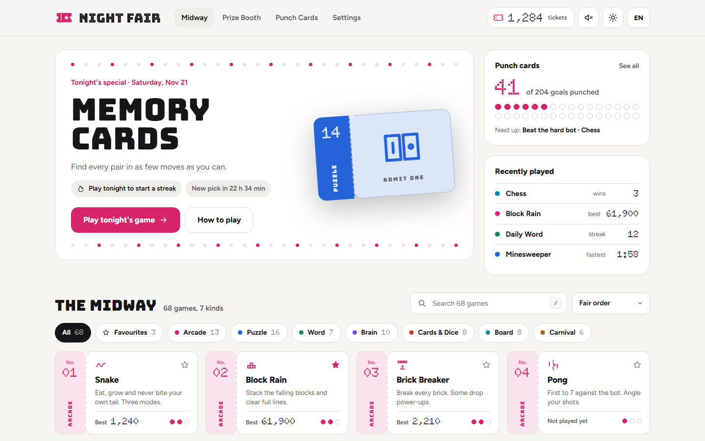
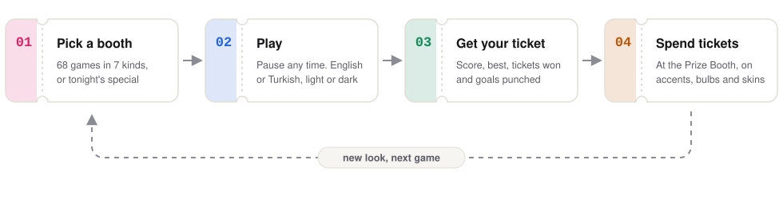
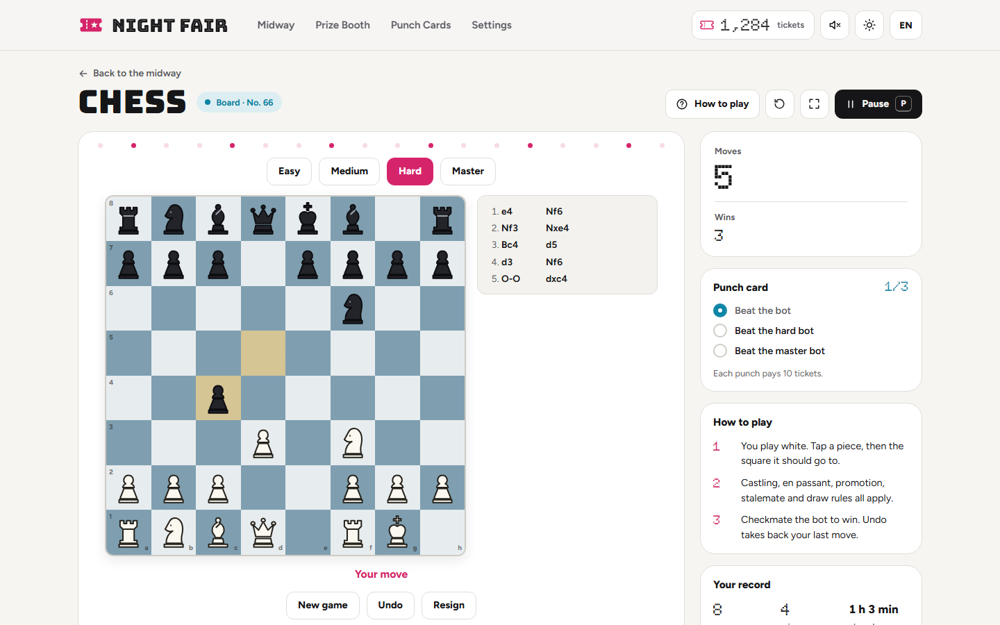
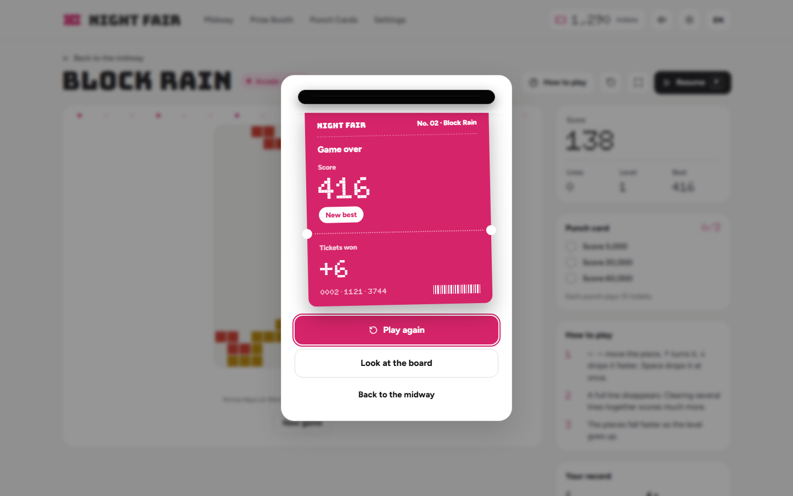
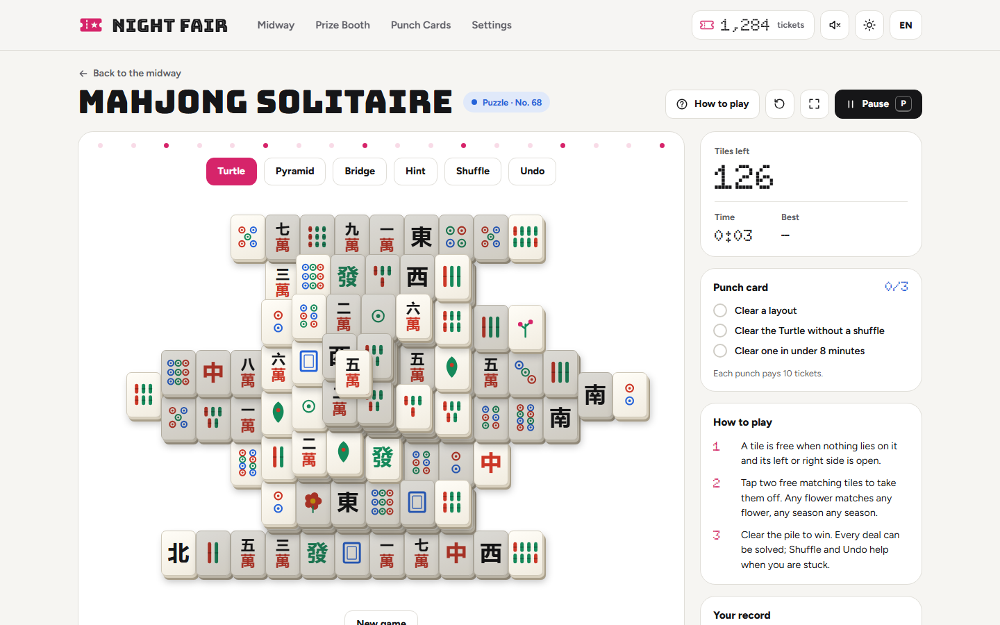
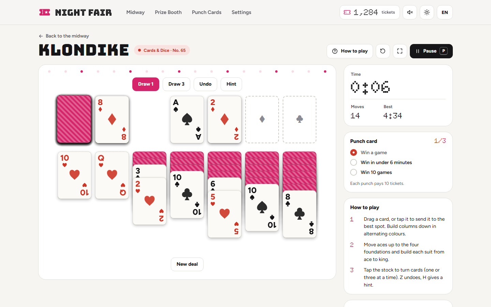
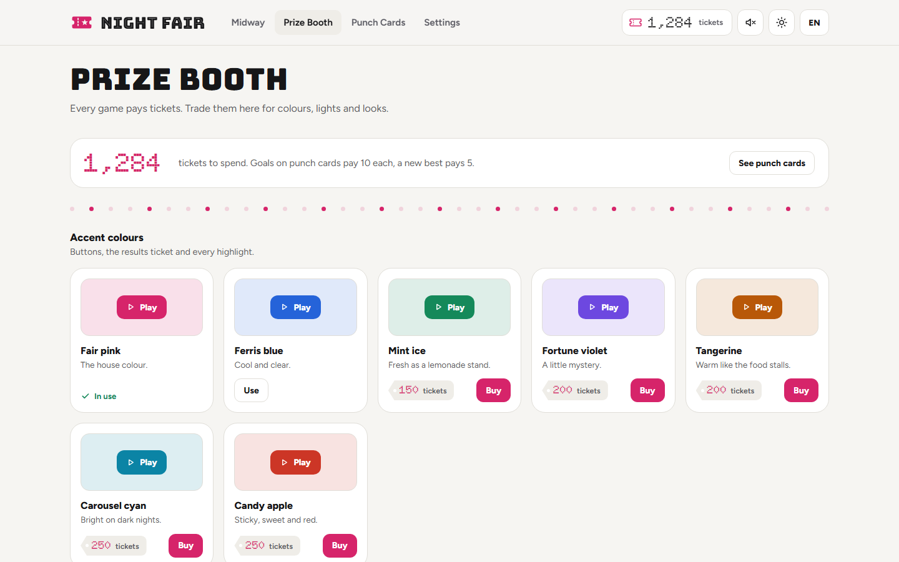
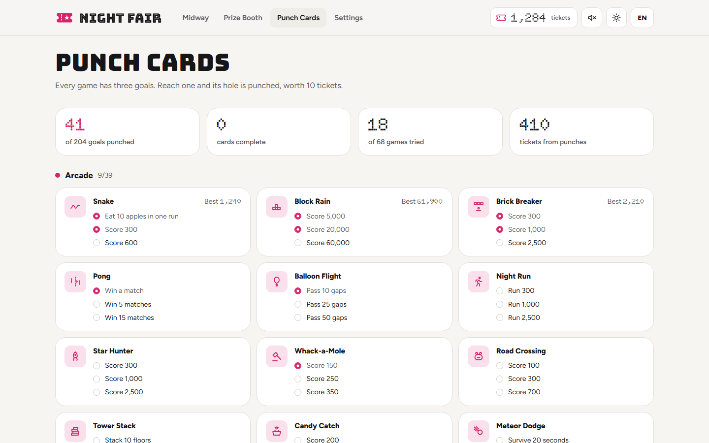

# Night Fair

**A pocket fairground of 68 games.** Arcade, puzzles, words, brain teasers, cards and board games against a bot, all in the browser.

[**nf.aslanlabs.online**](https://nf.aslanlabs.online) · English and Turkish · plays offline · closed source

<picture>
  <source media="(prefers-color-scheme: dark)" srcset="assets/screens/midway-dark.png">
  
</picture>

> [!NOTE]
> This repository is a showcase of the live site; the source code is private.

## What's inside

- **68 games in seven kinds:** 13 arcade, 16 puzzle, 7 word, 10 brain, 8 cards and dice,
  8 board games against a bot and 6 carnival games.
- **Chess, draughts, Klondike and Mahjong.** Chess with four bot levels, Turkish and
  English draughts, Klondike with draw one or three, and Mahjong solitaire whose deals
  can always be solved.
- **Tonight's special.** One game a night, the same for everyone, with a nightly streak.
- **A results ticket for every game.** It prints your score, your best and the tickets
  you won.
- **Punch cards.** Three goals per game, 204 in all. Every punch pays 10 tickets.
- **Prize Booth.** Spend tickets on accent colours, marquee bulbs, card backs and snake
  skins.
- **No account.** Progress stays in your browser, and a backup file moves it to another
  device.
- **Plays anywhere.** Keyboard, mouse or touch, light and dark themes, three text sizes,
  less motion on request. It installs like an app and works offline.

## How a night goes

<picture>
  <source media="(prefers-color-scheme: dark)" srcset="assets/loop-dark.svg">
  
</picture>

## Screens

<table>
<tr>
<td width="50%"><picture><source media="(prefers-color-scheme: dark)" srcset="assets/screens/chess-dark.png"></picture></td>
<td width="50%"><picture><source media="(prefers-color-scheme: dark)" srcset="assets/screens/ticket-dark.png"></picture></td>
</tr>
<tr>
<td><b>Chess</b>: four bot levels, a move list and undo.</td>
<td><b>Results ticket</b>: printed at the end of every game.</td>
</tr>
<tr>
<td><picture><source media="(prefers-color-scheme: dark)" srcset="assets/screens/mahjong-dark.png"></picture></td>
<td><picture><source media="(prefers-color-scheme: dark)" srcset="assets/screens/klondike-dark.png"></picture></td>
</tr>
<tr>
<td><b>Mahjong solitaire</b>: three layouts, hints, shuffle and undo.</td>
<td><b>Klondike</b>: drag or tap, undo and hints.</td>
</tr>
<tr>
<td><picture><source media="(prefers-color-scheme: dark)" srcset="assets/screens/prizes-dark.png"></picture></td>
<td><picture><source media="(prefers-color-scheme: dark)" srcset="assets/screens/cards-dark.png"></picture></td>
</tr>
<tr>
<td><b>Prize Booth</b>: what the tickets are for.</td>
<td><b>Punch cards</b>: every goal, game by game.</td>
</tr>
</table>

Screenshots use a sample fair pass and follow your GitHub theme.

## The games

| Kind | Games |
| --- | --- |
| Arcade (13) | Snake, Block Rain, Brick Breaker, Pong, Balloon Flight, Night Run, Star Hunter, Whack-a-Mole, Road Crossing, Tower Stack, Candy Catch, Meteor Dodge, Jump Tower |
| Puzzle (16) | Memory Cards, 2048, 15 Puzzle, Lights Out, Minesweeper, Sudoku, Nonogram, Sokoban, Tower of Hanoi, Peg Solitaire, Code Breaker, Simon, Maze Escape, Triple Pop, Pipe Network, Mahjong Solitaire |
| Word (7) | Daily Word, Hangman, Anagram Rush, Word Search, Speed Typer, Missing Vowels, Verbal Memory |
| Brain (10) | Reaction Time, Math Sprint, Chimp Test, Visual Memory, Stroop Test, Schulte Table, Digit Span, Dot Estimate, Missing Operator, Guess the Number |
| Cards and dice (8) | Blackjack, High-Low, Card War, Video Poker, Yahtzee, Pig, Golf Solitaire, Klondike |
| Board (8) | Tic-Tac-Toe, Connect 4, Dots & Boxes, Nim, Battleship, Reversi, Chess, Checkers |
| Carnival (6) | Spinning Wheel, Slot Machine, Plinko, High Striker, Duck Shoot, Horse Race |

## Design: Midway

The look comes from a fairground midway at night. Every game is a roll ticket with a
perforated stub in the colour of its kind, signs light up with chasing bulbs, scores sit
on dot-matrix boards and a finished game prints a ticket from a dispenser. Signs are set
in Bungee, everything you read in Figtree and numbers in Doto, on neutral black at night
or warm paper by day, with one accent colour you can change.

Built with React, TypeScript and Vite, served as static files from Cloudflare with a
strict content security policy.

## Türkçe

Gece Panayırı, tarayıcıda oynanan 68 oyunluk bir cep panayırı: arcade, bulmaca, kelime,
zekâ, kart ve zar, bota karşı masa oyunları ve panayır oyunları. Satranç, Türk daması,
Klondike ve Mahjong da var. Hesap gerekmez; ilerlemen tarayıcında kalır ve bir yedek
dosyasıyla başka cihaza taşınır. Site [nf.aslanlabs.online](https://nf.aslanlabs.online)
adresinde yayında; kaynak kodu kapalı.

---

© 2026 Berk Talha Aslan. All rights reserved.
